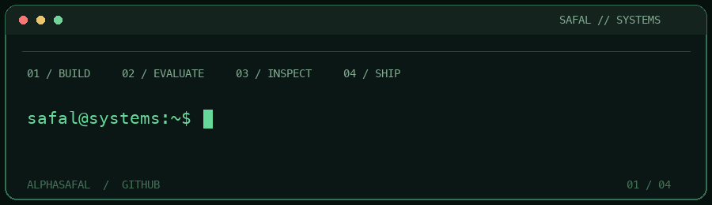

# Safal Gupta

**AI systems engineer in the making.** I build tools that expose how a system works: its state, failure modes, and evidence that it behaves as intended.

Computer Science at **VIT Vellore** · Based in India · Interested in AI infrastructure, evaluation, distributed systems, and robotics.

### Shipped

**[CONTRI — Open Source Compass](https://github.com/alphasafal/contri)** · [Chrome Web Store](https://chromewebstore.google.com/detail/njglkdpnkbieohopledjohcpkafogbid) · [Website](https://contri-two.vercel.app)

A Chrome extension that tells contributors, right on GitHub, whether an issue is really free to take (assignees, claims in the comments, linked pull requests), how quickly the maintainers reply, and whether the project is still active. Every number says what it covers, and missing data shows as unknown, never zero. No backend or tracking; optional read-only GitHub sign-in with the token encrypted at rest; 100+ unit tests plus Playwright end-to-end, accessibility and contrast checks in CI. Preact, TypeScript, Manifest V3, MIT licensed.

### Open-source contribution

**Merged**

- **[CodexBar #4528](https://github.com/steipete/CodexBar/pull/4528):** fixed cross-browser cookie permission diagnostics; added regression tests for error ordering.
- **[OpenStatus #2908](https://github.com/openstatusHQ/openstatus/pull/2908):** fixed email subscriptions on self-hosted status pages; added regression tests. Merged after review.
- Small fixes: corrected docs in [Stanford Stanza #1697](https://github.com/stanfordnlp/stanza/pull/1697) and [MIT CML blockly-plugins #91](https://github.com/mit-cml/blockly-plugins/pull/91).

**In review** (each one reported as an issue first, with a test that fails before the fix)

- **[NVIDIA NeMo Agent Toolkit #2467](https://github.com/NVIDIA/NeMo-Agent-Toolkit/pull/2467):** the ReAct output parser cut a tool's input at any later word "observation", so tools received truncated JSON with no error and no retry. Fixed the parser and added regression tests, including multiline inputs. Approved and queued to merge.
- **[AWS Powertools for Lambda (Python) #8669](https://github.com/aws-powertools/powertools-lambda-python/pull/8669):** `EventBridgeV2Envelope` raised `UnicodeDecodeError` on binary `application/octet-stream` payloads. Now tries JSON first and falls back to raw bytes. Bug confirmed by the maintainers; milestone 3.38.0.
- **[AWS Powertools for Lambda (Python) #8670](https://github.com/aws-powertools/powertools-lambda-python/pull/8670):** the Kafka Protobuf deserializer read Confluent message indexes as plain varints instead of zigzag, silently dropping fields. Fixed the decoding and added parametrised tests across index shapes; milestone 3.40.0.
- **[NVIDIA Warp #2159](https://github.com/NVIDIA/warp/pull/2159):** `array.transpose()` accepted repeated axes and returned a view that read past the end of the array. It now rejects them, matching NumPy.
- **[NVIDIA NeMo Curator #2534](https://github.com/NVIDIA-NeMo/Curator/pull/2534):** the arXiv LaTeX cleaner deleted the character before every inline `%` comment and missed a trailing `%`. Fixed the pattern and added a regression test.

### Open the source

| Project | What it explores |
| --- | --- |
| [AI Eval Engineering](https://github.com/alphasafal/ai-eval-engineering) | A TypeScript evaluation harness for prompts and agents, with graders, trajectory metrics, cost and latency tracking, and release gates. |
| [Production Agent Skills](https://github.com/alphasafal/production-agent-skills) | Eight portable engineering, data, and product skills with validation and evaluation cases. |
| [Exchange Core](https://github.com/alphasafal/exchange-core) | A C++20 limit order book with pre-trade risk, a write-ahead journal, deterministic replay, and network gateways. |
| [SAAYA VERIFY](https://github.com/alphasafal/saaya-verify) | An evidence-led cooling shelter research concept and tabletop fabrication candidate. |

### Current focus

- **AI systems:** evaluation, retrieval, agents, and efficient inference.
- **Systems engineering:** deterministic behavior, observability, storage, and distributed systems.
- **Robotics:** connecting software decisions to the physical world.

I learn by building the underlying pieces, testing them, and making the tradeoffs visible. My recent work spans Python, C++, TypeScript, and full-stack tools.

### Connect

[Portfolio](https://www.safalgupta.tech) · [LinkedIn](https://www.linkedin.com/in/safal-gupta/) · [X](https://x.com/Safallovetocode) · [HackerRank](https://www.hackerrank.com/profile/safallovetocode)
