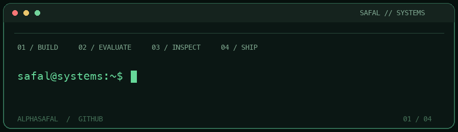

# Safal Gupta

**Software engineering · AI systems · open source**

Final-year Computer Science student at **VIT Vellore**, India. I build and investigate systems with a focus on correctness, failure modes, observability, security, and evidence-backed engineering.

Interested in **AI infrastructure and evaluation, backend/distributed systems, developer tooling, and systems security**.

### Building

**[CONTRI — Open Source Compass](https://github.com/alphasafal/contri)** · [Chrome Web Store](https://chromewebstore.google.com/detail/njglkdpnkbieohopledjohcpkafogbid) · [Website](https://contri-two.vercel.app)

A Chrome extension for evaluating GitHub issues and repository health: issue ownership and claims, linked pull requests, maintainer responsiveness, and recent activity. Reports evidence and uncertainty instead of treating missing data as zero. Built with Preact, TypeScript, and Manifest V3; includes automated tests. The project also includes **contri-mcp** for AI coding assistants and plugin packaging for agent workflows. [Source and documentation →](https://github.com/alphasafal/contri)

**[Production Agent Skills](https://github.com/alphasafal/production-agent-skills)** — 15 portable, role-organized skills for software engineering workflows, including test-first development, code review, incident response, security auditing, and system design. Includes automated validation, behavioral evaluations, and role packs.

**[AI Eval Engineering](https://github.com/alphasafal/ai-eval-engineering)** — TypeScript evaluation harness exploring deterministic test cases, graders, trajectories, latency and cost measurements, and release checks. Mock-based demonstrations are labelled as such, not presented as production-model results.

**[Exchange Core](https://github.com/alphasafal/exchange-core)** — C++20 limit-order-book and trading-infrastructure exploration, including pre-trade risk checks, a write-ahead journal, and deterministic replay.

**[SAAYA VERIFY](https://github.com/alphasafal/saaya-verify)** — Evidence-led cooling-shelter research and prototype concept.

### Open-source contributions

Selected **merged** contributions (links go directly to the accepted pull requests):

| Project | Contribution |
| --- | --- |
| [Apple Core AI Optimization #143](https://github.com/apple/coreai-optimization/pull/143) | Fixed Python invalid-escape warnings in quantization docstrings and added safeguards. |
| [Microsoft Semantic Kernel #14661](https://github.com/microsoft/semantic-kernel/pull/14661) | Corrected chat-history summarization behavior when retaining multiple summaries. |
| [NVIDIA NeMo Agent Toolkit #2467](https://github.com/NVIDIA/NeMo-Agent-Toolkit/pull/2467) | Prevented the ReAct parser from prematurely truncating tool input containing “observation”. |
| [AWS Powertools #8669](https://github.com/aws-powertools/powertools-lambda-python/pull/8669) | Corrected binary payload handling in the EventBridge envelope. |
| [AWS Powertools #8670](https://github.com/aws-powertools/powertools-lambda-python/pull/8670) | Fixed Confluent Protobuf message-index decoding using zigzag varints. |
| [Hugging Face Hub #5257](https://github.com/huggingface/huggingface_hub/pull/5257) | Excluded download-cache metadata from local checksum verification. |
| [Sentry Python #8119](https://github.com/getsentry/sentry-python/pull/8119) | Removed an invalid trailing comma from serialized tracing baggage. |
| [ProjectDiscovery Nuclei Templates #17746](https://github.com/projectdiscovery/nuclei-templates/pull/17746) | Fixed mismatched matcher variables in three CVE detection templates. |
| [Stanford Stanza #1697](https://github.com/stanfordnlp/stanza/pull/1697) | Corrected documented minimum supported Python version. |
| [OpenStatus #2908](https://github.com/openstatusHQ/openstatus/pull/2908) | Corrected visibility of email subscriptions for eligible self-hosted status pages. |
| [CodexBar #4528](https://github.com/steipete/CodexBar/pull/4528) | Improved cross-browser cookie permission error guidance. |
| [MIT CML Blockly Plugins #91](https://github.com/mit-cml/blockly-plugins/pull/91) | Corrected a package issue-tracker link. |

Additional merged infrastructure fixes:
- **[zyvor-cloud-netconfig #5](https://github.com/zyvorai/zyvor-cloud-netconfig/pull/5), [#6](https://github.com/zyvorai/zyvor-cloud-netconfig/pull/6), [#7](https://github.com/zyvorai/zyvor-cloud-netconfig/pull/7):** cloud metadata parsing and daemon resilience across Azure, GCP, and unsupported environments.
- **[zyvor-guestkit #66](https://github.com/zyvorai/zyvor-guestkit/pull/66), [#67](https://github.com/zyvorai/zyvor-guestkit/pull/67):** disk-format identification and Alpine package parsing.
- **[zyvor-netevd #134](https://github.com/zyvorai/zyvor-netevd/pull/134), [#135](https://github.com/zyvorai/zyvor-netevd/pull/135):** routing documentation and failure handling for supervised watchers.
- **[awesome-mcp-servers #19293](https://github.com/punkpeye/awesome-mcp-servers/pull/19293):** added CONTRI to the directory.

### In review

These are **open**, not merged. Reviews and CI states can change:

- **[Stripe Python #1978](https://github.com/stripe/stripe-python/pull/1978)** — encoding boolean and datetime values inside lists consistently with top-level values. **Maintainer-approved; awaiting merge.**
- **[Swift Foundation #2364](https://github.com/swiftlang/swift-foundation/pull/2364)** — correct Gregorian quarter calculations at quarter-end boundaries. **Approved; CI/merge pending.**
- **[Anthropic Python SDK #2021](https://github.com/anthropics/anthropic-sdk-python/pull/2021)** and **[#2030](https://github.com/anthropics/anthropic-sdk-python/pull/2030)** — isolate credential and AWS/Mantle client tests from ambient environment variables.
- **[Razorpay Node #492](https://github.com/razorpay/razorpay-node/pull/492)** — preserve network failures without exposing credentials through raw Axios errors.
- **[NVIDIA Warp #2159](https://github.com/NVIDIA/warp/pull/2159)** — reject repeated axes in transpose operations.
- **[NVIDIA NeMo Curator #2534](https://github.com/NVIDIA-NeMo/Curator/pull/2534)** — preserve characters preceding inline LaTeX comments.
- **[npm CLI #10290](https://github.com/npm/cli/pull/10290)** and **[#10292](https://github.com/npm/cli/pull/10292)** — publish-tag validation and malformed dependency-field handling; **review findings are being addressed**.
- **[Stripe Python #1987](https://github.com/stripe/stripe-python/pull/1987)** — multiple SDK core edge-case fixes; still in review.

[See all my open pull requests →](https://github.com/pulls?q=is%3Apr+is%3Aopen+author%3Aalphasafal)

### Current interests

- **Reliable AI:** evaluation harnesses, agent behavior, retrieval, model integration, and reproducible experiments.
- **Backend and systems:** APIs, concurrency, consistency, observability, and deterministic replay.
- **Secure engineering:** safe failure handling, input validation, isolation, and regression tests.
- **Open-source engineering:** small reproducible bugs, focused fixes, clear tests, and constructive maintainer reviews.

My recent work uses **Python, TypeScript/JavaScript, C++, and full-stack tooling**. I care more about tests and measured behavior than unverified performance claims.

### Connect

[Portfolio](https://www.safalgupta.tech) · [LinkedIn](https://www.linkedin.com/in/safal-gupta/) · [X](https://x.com/Safallovetocode) · [HackerRank](https://www.hackerrank.com/profile/safallovetocode)
