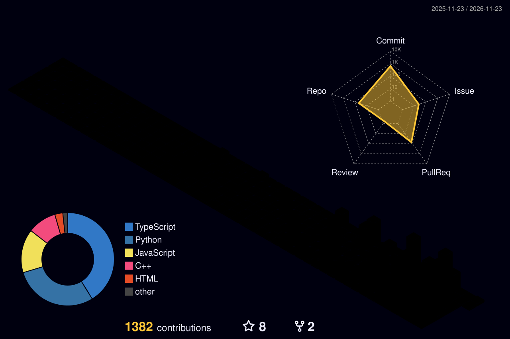

  <a href="https://safalgupta.tech">Portfolio</a> ·
  <a href="https://linkedin.com/in/safal-gupta">LinkedIn</a> ·
  <a href="https://x.com/safallovetocode">X</a> ·
  <a href="https://hackerrank.com/profile/safallovetocode">HackerRank</a>

<b>Final-year B.Tech CSE at VIT Vellore.</b> I fix bugs in the open-source tools I use, from AWS Powertools and Hugging Face Hub to Semantic Kernel and NVIDIA NeMo, and build developer tools of my own.

### 🧭 Building

| | |
|---|---|
| **[CONTRI](https://github.com/alphasafal/contri)** | Chrome extension + MCP server: is this repo alive, do maintainers reply, is the issue already claimed? Reports evidence and uncertainty, never fake zeros. |
| **[Production Agent Skills](https://github.com/alphasafal/production-agent-skills)** | 15 benchmarked skills for AI coding agents, organized by role, with behavioral evals. |
| **[AI Eval Engineering](https://github.com/alphasafal/ai-eval-engineering)** | TypeScript harness: deterministic graders, trajectory metrics, cost/latency tracking, release gates. |
| **[Exchange Core](https://github.com/alphasafal/exchange-core)** | C++20 limit order book with pre-trade risk checks, write-ahead journal and deterministic replay. |
| **[VAJRA](https://github.com/alphasafal/vajra)** | Static malware triage engine: dissects a suspicious file without running it and explains every verdict. |
| **[Lastseat](https://github.com/alphasafal/lastseat)** | Race-proof team formation for 10,000-person hackathons: fifty people click "join" on the last seat, exactly one gets it. |
| **[GitRishta](https://github.com/alphasafal/gitrishta)** | Your GitHub profile as an Indian shaadi biodata. Gotra: JavaScript. |

Everything above regenerates daily from the GitHub API, so no number here is typed by hand. [Open PRs →](https://github.com/pulls?q=is%3Apr+author%3Aalphasafal+is%3Aopen)
